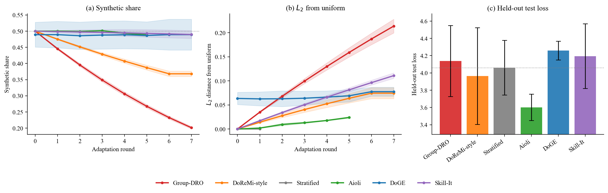

<div align="center">

# The Compute Floor of Data Mixing

### When Loss-Based Reweighters Start to Drain Easy Synthetic Text

**Shayan Salehi**<sup>1</sup> · **Iman Mohammadi**<sup>2</sup>

<sup>1</sup>University of Waterloo &nbsp;&nbsp; <sup>2</sup>University of California, Irvine

*MOSS Workshop at COLM 2026*

[](Paper/moss_main.pdf)
[](https://mixing-floor.github.io)
[](LICENSE)
[](requirements.txt)
[](https://github.com/mixing-floor/compute-floor/actions/workflows/tests.yml)

</div>

---

Automatic data-mixing methods are usually validated with pretraining sweeps that only well-funded groups can afford. We show that one behavioural difference between them is readable at a budget a single GPU can reach, and we locate the **compute floor** below which it disappears into seed noise.

We split a pool of 18 domains by provenance (**9 real Pile subsets** vs. **9 synthetic instruction corpora**), give six reweighting methods the same per-domain validation-loss signal, and record how each one moves the **synthetic share** of the mixture.

<p align="center">
  
</p>

## Key findings

* **Two families.** At Pythia-160m (2.30 × 10¹⁷ FLOPs per run, 3 seeds), loss-monotone reweighters drain the synthetic share toward the harder real text: **Group-DRO 0.50 → 0.20** and **DoReMi-style 0.50 → 0.37**. Aioli, DoGE and Skill-It stay near the uniform 0.50 start.
* **Why.** Online training opens a loss gap of about one nat between provenances (real 4.09 vs. synthetic 3.06 at the final round). A score that is monotone in a domain's own loss must chase the higher-loss class; an interaction or gradient-alignment score need not.
* **A compute floor.** The split already holds at the LIGHT tier (1.2 × 10¹⁶ FLOPs, pythia-70m). At the 2.5 × 10¹⁴ FLOP smoke-test tier it becomes seed-dominated: Group-DRO has no net direction (std 0.35) and DoReMi-style reverses (0.75).
* **No quality claim.** Held-out test loss, hedged at n = 3 and confounded by online training, gives the least-moving method (Aioli, 3.60 nats) the lowest mean. No loss-mover beats the uniform control by more than seed scatter.

| Method | Signal family | Final synthetic share | L2 from uniform | Held-out test loss |
|---|---|---:|---:|---:|
| Group-DRO | loss-monotone | 0.201 ± 0.004 | 0.214 | 4.14 ± 0.41 |
| DoReMi-style | loss-monotone (excess loss) | 0.368 ± 0.008 | 0.074 | 3.96 ± 0.56 |
| Aioli | interaction (mixing law) | 0.489 ± 0.005 | 0.024 | **3.60 ± 0.15** |
| DoGE | gradient alignment | 0.489 ± 0.048 | 0.077 | 4.26 ± 0.11 |
| Skill-It | hybrid (skills graph) | 0.490 ± 0.012 | 0.111 | 4.19 ± 0.37 |
| Stratified | uniform control | 0.500 ± 0.000 | 0.000 | 4.06 ± 0.32 |

<sub>HEAVY tier, scenario S2 (9 real / 9 synthetic), mean ± std over seeds 0, 1, 2. Source: [`Results/main`](Results/main).</sub>

> **Scope.** This is a behavioural study of *which mixture each policy chooses*. It does not train models to convergence and does not claim that any method produces a better final model.

## Repository layout

```
compute-floor/
├── Code/
│   ├── run_experiment.py        # single source of truth for every reported number
│   ├── visualize_results.py     # regenerates the appendix figures from Results/main
│   ├── make_central_figure.py   # regenerates Figure 1 (Paper/figures/f_central.png)
│   └── diagnostics/             # signal-level instrumentation (raw DoGE / Skill-It / Aioli signals)
├── Results/
│   ├── main/                    # released runs for all three compute tiers (CSV, NPY, FLOP tables)
│   ├── figures/                 # per-method figures generated from Results/main
│   └── diagnostics/             # two instrumented runs, their manifests and logs
├── Paper/                       # LaTeX source, figures and compiled PDF
├── tests/                       # CPU-only unit tests
├── requirements.txt
└── CITATION.cff
```

[`Results/README.md`](Results/README.md) documents every released file and its columns.

## Installation

```bash
git clone https://github.com/mixing-floor/compute-floor.git
cd compute-floor
python -m venv .venv && source .venv/bin/activate   # Windows: .venv\Scripts\activate
pip install -r requirements.txt
```

Install a CUDA build of PyTorch that matches your driver ([pytorch.org/get-started](https://pytorch.org/get-started/locally/)). Data streams from the Hugging Face Hub, so the machine needs internet access. Nothing is downloaded up front.

## Reproducing the paper

All commands run from the repository root. They write to `runs/`, which is gitignored, so the released numbers in `Results/main` are never overwritten. Compare your outputs against them.

**1. Smoke test** (minutes, also runs on CPU; a wiring check, not a result):

```bash
python Code/run_experiment.py --config SUPER_LIGHT --seeds 0 --scenario S2_9R_9S --eval-test --out-dir runs/main
```

**2. The three compute tiers** reported in the paper (3 seeds each):

```bash
python Code/run_experiment.py --config HEAVY       --seeds 0 1 2 --scenario S2_9R_9S --eval-test --out-dir runs/main
python Code/run_experiment.py --config LIGHT       --seeds 0 1 2 --scenario S2_9R_9S --eval-test --out-dir runs/main
python Code/run_experiment.py --config SUPER_LIGHT --seeds 0 1 2 --scenario S2_9R_9S --eval-test --out-dir runs/main
```

**3. Figures:**

```bash
python Code/visualize_results.py --out-dir runs/main --fig-dir runs/figures
python Code/make_central_figure.py --out-dir runs/main --fig runs/figures/f_central.png
```

Run without arguments, both scripts read the released `Results/main` and regenerate the figures shipped in `Results/figures` and `Paper/figures`.

**Optional extensions** that the runner supports but the paper does not report:

| Flag | Effect |
|---|---|
| `--scenario ALL` | also runs S1 (1 real / 9 synthetic) and S3 (9 real / 1 synthetic) |
| `--static-eval` | retrains on each method's final mixture and scores it on the test split (removes the online-training confound; expensive) |
| `--no-baselines` | Aioli only |
| `--extra-heuristics` | two legacy validation-loss heuristics (Gen-Delta, Improvement-Window); these are **not** DoGE or Skill-It and never appear in paper figures |

### Compute budget

FLOPs per run are estimated as 6·N·D with N the total parameter count and D = max_steps · batch · ctx.

| Tier | Model | ctx | batch | max_steps | Tokens / run | FLOPs / run |
|---|---|---:|---:|---:|---:|---:|
| SUPER_LIGHT | pythia-70m | 2048 | 2 | 144 | 5.9 × 10⁵ | 2.5 × 10¹⁴ |
| LIGHT | pythia-70m | 1024 | 4 | 7 200 | 2.95 × 10⁷ | 1.2 × 10¹⁶ |
| **HEAVY** (reported) | pythia-160m | 2048 | 8 | 14 400 | 2.36 × 10⁸ | 2.30 × 10¹⁷ |

DoGE adds +3 % (alignment micro-batches) and Skill-It +25 % (one-time skills-graph learning) over the HEAVY base. The full headline study (6 methods × 3 seeds) is about 4.3 × 10¹⁸ FLOPs. Our runs used one NVIDIA A100 (80 GB), at a few GPU-hours per seed for all six methods. Exact per-tier tables are in `Results/main/flops_<TIER>.csv`.

### Signal-level diagnostics

`Code/diagnostics` wraps the unmodified runner and logs the raw signals each update consumes: DoGE's gradient inner products split into self and cross-provenance terms, Skill-It's learned influence graph, and Aioli's interaction-matrix blocks. It defines two experiments:

```bash
python Code/diagnostics/run_diagnostics.py doge160_signal    --seeds 0 1 2   # DoGE signal audit, Pythia-160m
python Code/diagnostics/run_diagnostics.py pythia70m_heavy   --seeds 0 1 2   # all methods, Pythia-70m at HEAVY settings
python Code/diagnostics/run_diagnostics.py pythia70m_heavy   --dry-run       # print the resolved plan only
```

Each run writes a `run_manifest.json` with the source-runner hash, git commit and environment. The released `Code/run_experiment.py` is byte-identical to the runner recorded in `Results/diagnostics/*/run_manifest.json` (sha256 `3f2b0010…f369`).

### Tests

```bash
python -m unittest discover -s tests -v
```

These tests are CPU-only. The DoGE tensor test skips itself when PyTorch is unavailable.

### Building the paper

```bash
cd Paper && latexmk -pdf moss_main.tex
```

Use **pdfLaTeX**. The COLM template loads Palatino and Inconsolata as Type 1 fonts, and XeLaTeX silently substitutes Latin Modern for them.

## Methods and faithfulness

| Label | Implementation | Deviations from the original |
|---|---|---|
| **Aioli** | faithful port of [HazyResearch/aioli](https://github.com/HazyResearch/aioli) | HEAVY uses a stateful EMA (0.1) path instead of the reference's stateless reset |
| **DoGE** | faithful to Fan et al. (2024), Alg. 1 | online single model, per-round estimation, mean-abs score scaling |
| **Skill-It** | faithful to Chen et al. (2023), Alg. 1 | continual-pretraining regime, uniform init, mean-abs scaling |
| **DoReMi-style** | approximate | validation-shard loss; no max(0,·) clip or c = 10⁻³ smoothing; frozen pretrained reference |
| **Group-DRO** | approximate | multiplicative high-loss update; no joint min-max model step |
| **Stratified** | exact | uniform p = 1/k control |

Three invariants are enforced in code: train/val/test token blocks are disjoint (`split_seed = 1234`, with a hard non-empty assert); an empty shard's loss is `NaN`, never `0.0`; and all models continue from pretrained Pythia checkpoints rather than training from scratch.

## Data

All corpora stream from the Hugging Face Hub.

| Provenance | Domain | Hugging Face dataset |
|---|---|---|
| Real | Wikipedia (en), Pile-CC, OpenWebText2, Github, PubMed Abstracts, StackExchange, FreeLaw, USPTO Backgrounds, ArXiv | [`ola13/small-the_pile`](https://huggingface.co/datasets/ola13/small-the_pile) |
| Synthetic | UltraChat | [`HuggingFaceH4/ultrachat_200k`](https://huggingface.co/datasets/HuggingFaceH4/ultrachat_200k) |
| Synthetic | Self-Instruct slot (human-written) | [`databricks/databricks-dolly-15k`](https://huggingface.co/datasets/databricks/databricks-dolly-15k) |
| Synthetic | Cosmopedia | [`HuggingFaceTB/cosmopedia`](https://huggingface.co/datasets/HuggingFaceTB/cosmopedia) |
| Synthetic | Code-Alpaca | [`sahil2801/CodeAlpaca-20k`](https://huggingface.co/datasets/sahil2801/CodeAlpaca-20k) |
| Synthetic | GPTeacher | [`teknium/GPTeacher-General-Instruct`](https://huggingface.co/datasets/teknium/GPTeacher-General-Instruct) |
| Synthetic | WizardLM-70k | [`WizardLMTeam/WizardLM_evol_instruct_70k`](https://huggingface.co/datasets/WizardLMTeam/WizardLM_evol_instruct_70k) |
| Synthetic | Alpaca-52k | [`tatsu-lab/alpaca`](https://huggingface.co/datasets/tatsu-lab/alpaca) |
| Synthetic | ShareGPT | [`RyokoAI/ShareGPT52K`](https://huggingface.co/datasets/RyokoAI/ShareGPT52K) |
| Synthetic | Open-Platypus | [`garage-bAInd/Open-Platypus`](https://huggingface.co/datasets/garage-bAInd/Open-Platypus) |

Synthetic examples are wrapped in a fixed `### Instruction:` / `### Response:` template; real text stays untemplated. The synthetic class is therefore defined by instruction format rather than strictly by model generation. The slot labelled Self-Instruct is the human-written Dolly-15k.

**Licensing.** This repository releases code and aggregate statistics only (losses, mixture weights, FLOPs), never raw text or model weights. Each corpus remains under its own terms, so check the dataset card before reusing it. Several carry non-commercial or share-alike conditions (for example, Alpaca is CC BY-NC 4.0 and Dolly-15k is CC BY-SA 3.0). ShareGPT contains user-shared chatbot conversations. The nine Pile subsets exclude Books3.

## Limitations

The study covers one scenario (S2), one model size per tier and three seeds. Test loss is measured after online training, not after a static retrain, so it mixes mixture choice with training dynamics. Provenance and instruction template are confounded. Whether the split holds above 160M parameters, and whether it vanishes on a homogeneous all-real pool as the theory predicts, are left open. Section 5 and Appendix A of the paper discuss each point.

## Citation

```bibtex
@inproceedings{salehi2026computefloor,
  title     = {The Compute Floor of Data Mixing: When Loss-Based Reweighters Start to Drain Easy Synthetic Text},
  author    = {Salehi, Shayan and Mohammadi, Iman},
  booktitle = {MOSS Workshop at the Conference on Language Modeling (COLM)},
  year      = {2026},
  url       = {https://mixing-floor.github.io}
}
```

GitHub's **Cite this repository** button reads the same entry from [`CITATION.cff`](CITATION.cff).

## License and acknowledgements

Code is released under the [MIT License](LICENSE). We thank the Aioli authors for their reference implementation and EleutherAI for the open Pythia checkpoints.

Questions and issues are welcome on the [issue tracker](https://github.com/mixing-floor/compute-floor/issues).
